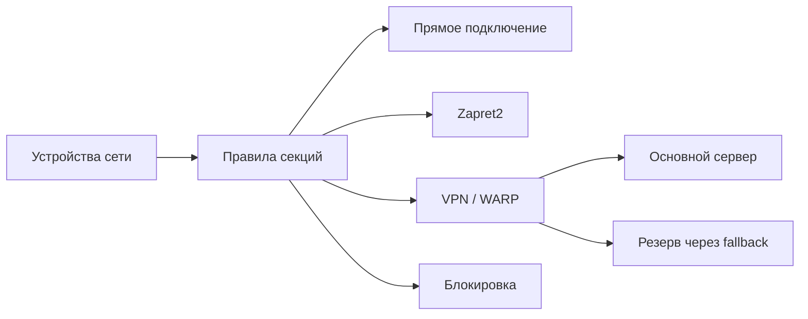

<p align="center"></p>
<h1 align="center">K.A.B.A.N.-MAX</h1>
<p align="center"><b>Ваши устройства. Ваши маршруты. Один роутер.</b><br>VPN, WARP, Zapret2 и DNS под управлением OpenWrt</p>
<p align="center">
<a href="https://github.com/fefenke/kaban-max/releases/tag/0.2.3"></a>


<a href="LICENSE"></a>
</p>
<p align="center"><a href="#установка">Установить</a> · <a href="https://fefenke.github.io/kaban-max/">Документация</a> · <a href="https://github.com/fefenke/kaban-max/releases/tag/0.2.3">Скачать пакеты</a> · <a href="https://github.com/fefenke/kaban-max/issues">Обратная связь</a></p>

**K.A.B.A.N.-MAX** — приложение для роутеров OpenWrt, которое распределяет трафик между прямым подключением, VPN и Zapret2. В веб-интерфейсе LuCI выберите сайты и устройства, назначьте им подключения и настройте резервные маршруты.

Можно отправить видеосервисы через WARP, отдельные сайты через VLESS, применить Zapret2 к выбранной секции, а остальной трафик оставить на прямом подключении. Правила работают на роутере и охватывают устройства выбранной секции.

## Возможности

| Задача | Что есть в K.A.B.A.N.-MAX |
| --- | --- |
| **Распределять трафик** | Домены, подсети, порты, устройства, интерфейсы; готовые списки сервисов и собственные списки |
| **Подключаться к VPN** | VLESS/REALITY, VMess, Shadowsocks, Trojan, Hysteria2, TUIC; импорт ссылок и подписок, группы серверов и каскады |
| **Использовать туннели** | Cloudflare WARP с регистрацией профилей, WireGuard и OpenVPN в варианте ядра `base` |
| **Держать резерв** | Fallback с приоритетами, подтверждением недоступности и возвратом после серии успешных проверок |
| **Выбирать по задержке** | URLTest для автоматического выбора подключения из группы |
| **Настраивать Zapret2** | Стратегии для отдельных секций, проверка перед применением, установка и обновление из LuCI |
| **Подбирать маршрут при сбое** | Авторутинг с проверкой Direct/WARP, ручным подтверждением или автоприменением |
| **Управлять DNS** | Резолверы и DNS по правилам, шифрованные подключения, FakeIP IPv4/IPv6 и резервирование DNS |
| **Видеть происходящее** | Подключения, домены, устройства, трафик, задержки, состояние групп и журналы |

## Установка

**Выпуск 0.2.3 · ядро 1.14.4-r47**

Готовые пакеты рассчитаны на OpenWrt с архитектурой **`aarch64_cortex-a53`**. Доступны **APK** и **IPK**. Для другой архитектуры потребуется собственная сборка ядра.

Выполните в SSH роутера:

```sh
wget -T 15 -O /tmp/kabanmax-install.sh https://raw.githubusercontent.com/fefenke/kaban-max/main/install.sh && KABANMAX_RELEASE=0.2.3 KABANMAX_REINSTALL=1 sh /tmp/kabanmax-install.sh --lang ru
```

Установщик определяет пакетный менеджер и архитектуру, подбирает компоненты и проверяет SHA256. Команда подходит и для повторной установки **той же 0.2.3**. Во время установки служба перезапускается, соединения через неё могут прерваться.

После установки откройте **Службы → K.A.B.A.N.-MAX**.

| Вариант ядра | Для чего выбрать |
| --- | --- |
| **base** | Прокси-протоколы и туннели WARP, WireGuard, OpenVPN |
| **tiny** | Прокси-протоколы без WARP, WireGuard и OpenVPN; компактный вариант |

При обновлении сохраняется выбранный вариант. Для явного выбора добавьте `--variant base` или `--variant tiny`.

[Подробная установка и удаление](docs/guide/install.md) · [Пакеты и контрольные суммы](https://github.com/fefenke/kaban-max/releases/tag/0.2.3)

## Первые шаги

1. **Добавьте подключение.** Импортируйте ссылку или подписку, настройте сервер либо создайте профиль WARP.
2. **Создайте секцию.** Выберите домены, сервисы, подсети или устройства, к которым относятся правила.
3. **Назначьте действие.** Подключение, обход через Zapret2, прямой маршрут, блокировка или DNS-политика.
4. **Добавьте резерв.** Объедините подключения в fallback для перехода на другой сервер при недоступности основного.
5. **Сохраните настройки.** Проверьте состояние подключений и фактические маршруты в мониторинге.



[Быстрый старт](docs/guide/quick-start.md) · [Секции и правила](docs/sections/index.md) · [Zapret2](docs/guide/zapret2.md)

## WARP и резервные подключения

Профили WARP регистрируются в интерфейсе, в том числе через выбранную секцию. Несколько профилей работают как отдельные подключения: назначайте их правилам или объединяйте в fallback.

Fallback использует заданный порядок серверов. Основной URL и независимый адрес подтверждения выбираются из списка или вводятся вручную. По умолчанию используются разные адреса Google и Cloudflare.

- Если хотя бы одна проверка проходит, подключение считается доступным.
- Если оба адреса недоступны, группа подтверждает сбой повторной проверкой и ищет резерв.
- На резерве основной сервер проверяется с отдельным интервалом. Возврат происходит после заданного числа последовательных успехов.
- Если недоступны все серверы, группа сохраняет текущий выбор и продолжает проверки.

Рабочий порт WARP хранится отдельно для каждого профиля. После загрузки роутера новый порт может быть записан в конфиг один раз, после десяти минут стабильной работы. Подошедший сохранённый порт повторно не записывается.

[WARP](docs/tunnels/warp.md) · [Параметры fallback](docs/connections/fallback.md)

## Авторутинг

Авторутинг подбирает альтернативу для соединений, которые не проходят через исходный маршрут секции с Zapret2: собирает диагностику и проверяет доступные направления **Direct / WARP**.

| Состояние | Что означает |
| --- | --- |
| **Ожидают** | Исходная ошибка и результат проверки доступны для ручного решения или автоприменения |
| **Применены** | IP направляется по принятому маршруту для всех устройств выбранной секции |
| **Исключены** | IP исключён из обработки авторутингом |

Успешный результат сохраняется: принятые IP не отправляются на периодические повторные проверки. Записи и диагностика ограничены общим бюджетом памяти. Сохранение реестра на постоянное хранилище настраивается отдельно.

Автоприменение включается явно. Отдельные параметры разрешают IP без домена и применение при неподтверждённом протоколе. Второй вариант означает согласие на маршрут, для которого проверка протокола не дала полного подтверждения.

[Правила и авторутинг](docs/sections/index.md)

## DNS и наблюдение

DNS-политики задают резолвер и подключение для запросов отдельных секций. FakeIP связывает доменные правила с соединениями устройств; доступны IPv4 и IPv6. При перезагрузке ядра локальная защита DNS удерживает перехватываемые запросы от ухода через обычный DNS в обход политики.

В мониторинге видны домены, устройства, направления и объём трафика. Панель подключений показывает состояние серверов и задержку. Журналы фильтруются по уровню: подробности сетевых потоков доступны в Debug, значимые отказы подключений содержат контекст для диагностики. При выборе Warn отображаются также Error и более высокие уровни.

## Документация и помощь

| Раздел | Ссылка |
| --- | --- |
| Пользовательское руководство | [Открыть сайт](https://fefenke.github.io/kaban-max/) |
| Установка и обновление | [Инструкция](docs/guide/install.md) |
| Начальная настройка | [Быстрый старт](docs/guide/quick-start.md) |
| Резервные подключения | [Fallback](docs/connections/fallback.md) |
| Сообщить о проблеме | [GitHub Issues](https://github.com/fefenke/kaban-max/issues) |

При обращении укажите версии приложения и ядра, модель роутера, версию OpenWrt и шаги воспроизведения. Перед отправкой конфигов и журналов удалите ключи, токены, пароли, ссылки подписок и личные адреса.

## Разработка и исходники

Интерфейс написан на TypeScript для LuCI, управление конфигурацией — на ucode. Сетевое ядро собирается из закреплённого upstream и открытой серии патчей; правила трафика используют nftables.

[Сборка и тесты](docs/development.md) · [Исходники ядра](core/README.md) · [Правила проекта](AGENTS.md) · [История выпусков](CHANGELOG.md)

Основано на [Forkop](https://github.com/ushan0v/forkop). Авторы компонентов и лицензии — в [CREDITS.md](https://github.com/fefenke/kaban-max/blob/main/CREDITS.md) и [LICENSE](https://github.com/fefenke/kaban-max/blob/main/LICENSE).
