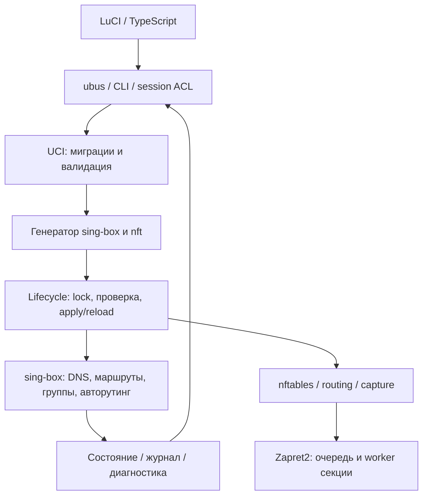

# Архитектура

Текущий инженерный обзор; версия и приёмка — [PROJECT_STATE](PROJECT_STATE.md). Источник истины поведения — код и относящиеся к нему проверки, а не исторические планы.

## Поток управления

Applied late-DNS r41: Direct сохраняет исходный resolver, а `DialContextWithWrapper` добавляет IP hook только к application dials после DNS. Observation удаляется из DNS transport context и явно привязывается к concrete-IP wrapper. Соседние адреса и exclusions не перенаправляются. Persistent failures различают bypass исходного маршрута и applied_target_failed; RAM sidecar хранит attribution отдельно от routing intent. [Контракт и проверки](AUTO_ROUTING_LATE_DNS.md).

Обновления при отказе GitHub API используют bounded/validated raw manifests из `release/` и тот же version/downgrade guard. UI bootstrap берётся из main с сохранением выбранного release pin; backend manifest для pin проверяется до запуска. Installer качает пакеты и SHA256SUMS по публичным pinned URLs, сохраняя проверку содержимого. [Транспорт и публикация](BUILD_AND_DEPLOY.md).

Принятые транспортные ошибки авторутинга выводятся отдельным Warn исходного маршрута; обычный транспортный connection log остаётся Debug. Executable acceptance включает Warn. SOCKS ошибка до handshake не даёт TLS evidence: автоматическая HTTPS проверка требует подтверждённого протокола либо явно настроенного body prefix.

Applied diagnostics r40: `config/auto_diagnostics.uc` хранит отдельный bounded RAM snapshot, registry пишет туда diagnostic context после успешного сохранения разрешений, UI присоединяет его только по точному binding. Compact grant/flash и authorization не зависят от диагностических текстов. Один indexed snapshot на view. [Выпуск](RELEASE_023.md).

Minute timer state service вызывает `diagnostics/warp_ports.uc`: authenticated core path status → RAM stability/boot allowance → редкий UCI commit через изолированный cursor под lifecycle lock. Контракт задержки и нулевых записей при рабочем порте — [WARP port hints](WARP_PORT_HINTS.md). Контракт WARP сохранён в текущем preview 0.2.9/r39; section-wide IP approvals и границы установки — [PREVIEW_029](PREVIEW_029.md).

## Ответственность слоёв

| Слой | Контракт |
| --- | --- |
| Frontend | Формы и отображение; пользовательские намерения через RPC. Не выдаёт собственное сетевое наблюдение за разрешение core. `src/main.ts` собирается в LuCI bundle. |
| UCI/config | Нормализация, миграции, валидация входа, имена и ссылки. Не менять UCI ради виртуального поля формы. |
| Generator + nft | Две согласованные части маршрутизации. Изменение DNS/mark/order проверять в обоих путях. |
| Lifecycle | Сериализация start/stop/apply, проверка готовности, учёт изменения конфигурации во время работы. |
| Core patches | Дополнения sing-box поверх pinned upstream; не отдельный произвольно обновляемый fork checkout. |
| State service | Резидентный ubus service, наблюдение процессов/логов, ограниченные снимки и capture авторутинга. |

## Lifecycle и сбои

- Итоговый runtime JSON определяет необходимость reload. No-op Save не должен создавать лишние записи/перезапуск.
- Реальное изменение JSON пересоздаёт core; существующие TCP-соединения могут закрыться. Частичный reload не обещается.
- FakeIP/cache восстанавливаются только из сохранившегося файла. `/tmp` обычно tmpfs и очищается при reboot.
- При неожиданном завершении sing-box перехват приостанавливается до готовности процесса после procd restart. Сообщение OOM диагностирует выбранную жертву, не источник всего расхода памяти.
- Нельзя подменять workers/lifecycle внешними одноразовыми shell-командами. Проверять PID/очередь/mark конкретной секции, а не только наличие процесса.

## Авторутинг

Исходный first-match выбирается до опционального перенаправления. Реальная source-owned ошибка создаёт evidence; проверки и ручное применение используют атрибутированный flow и core guards. Ошибка альтернативы не становится ошибкой исходного Zapret.

Реестр разделён на компактные routes/exclusions и временную диагностику. Capture и flash checkpoint сериализованы lifecycle lock. Frontend получает страницы без private members; bulk повторно проверяет source/filter и ID. Точный контракт памяти, сохранения и восстановления — [AUTO_ROUTING_STORAGE](AUTO_ROUTING_STORAGE.md), field fixes — [AUTO_ROUTING_FIELD_ERRORS](AUTO_ROUTING_FIELD_ERRORS.md).

## Хранилища

| Данные | Источник/место | Срок |
| --- | --- | --- |
| Пользовательская конфигурация | UCI `kabanmax` | постоянная; фактический overlay зависит от устройства |
| Runtime sing-box JSON | `config_path`, default `/etc/sing-box/config.json` | пересоздаётся генератором |
| Core cache | `cache_path`, default `/tmp/sing-box/cache.db` | default не переживает reboot |
| Авторутинг | RAM; компактные applied/suppression JSON в `/etc/kabanmax/` | configurable checkpoint; несохранённые изменения могут потеряться |
| Private autoroute context | `/var/run/kabanmax/` | RAM-only; bounded/retention |
| Журнал приложения | приватный `/tmp/kabanmax-journal/archive.json` | до 24h/256 КиБ текста/2048 строк; JSON до 512 КиБ; сбор каждые 1.5s, не flash |
| Сетевая статистика fallback | RAM core | отдельно от журнала приложения |

Точные владельцы — [COMPONENTS](COMPONENTS.md), сетевые инварианты — [NETWORKING](NETWORKING.md), обоснования — [DECISIONS](DECISIONS.md).

Журнал ограничен также по размеру строки/входного batch и RPC-страницы; неизменившийся ответ не собирает полный текст. Core отдаёт до 200 последних соединений в HTTP/WebSocket и реальный `connectionsTotal`, LuCI явно показывает неполный список. Это ограничивает диагностические аллокации, не число пользовательских соединений. Контракт, миграция временного архива, замеры и границы — [LOGGING](LOGGING.md).

Core WAN monitor живёт в Router lifecycle scope на OpenWrt; logger output gate подавляет связанные сетевые Warn/Error только в подтверждённом outage. Состояние RAM-only, переходы сериализованы с выводом двух WAN-событий; fallback/autoroute не приостанавливаются. [Доступность, источники причин и границы](NETWORK_AVAILABILITY.md).
